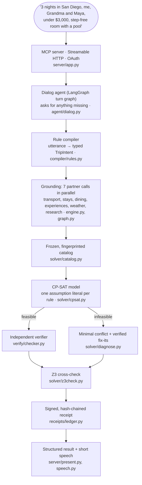

# Plexis

[](https://github.com/siddhi-works/Plexis/actions/workflows/ci.yml)   [](LICENSE)

**A trip-planning agent where the language model never decides the trip.**

Most AI travel agents let a language model write the itinerary and ask you to double-check it. Plexis treats a trip request as a constraint problem instead: your words are compiled into exact rules, a solver finds a plan that satisfies all of them, and an independent checker verifies the result before anything is said or booked. Every plan ships with a signed, tamper-evident receipt.

Built for Amazon's *Build, Ship, Shape* Developer Hackathon (Alexa+ track) as an Alexa+ add-on: a self-hosted MCP server that Alexa+, or any MCP client, can call.

<p align="center"></p>


[Watch the launch video (1:12)](docs/media/plexis-demo.mp4)

---

## Why not just use an LLM?

A language model predicts plausible text. That is great for understanding "somewhere warm, Grandma uses a wheelchair, nothing over three grand", and bad at guaranteeing that a 21-rule itinerary actually satisfies all 21 rules. Prompting harder does not change that.

So Plexis separates the two jobs:

| Job | Who does it | Why |
|---|---|---|
| Understand the request | A deterministic rule compiler (Bedrock optional, for phrases it doesn't know) | Fast (about 1 ms), reproducible, and every rule is traceable to the words that produced it |
| Choose the plan | Google OR-Tools CP-SAT | Either finds a plan that satisfies every rule, or proves none exists |
| Check the plan | A separate verifier that shares no code with the solver | A system shouldn't grade its own homework |
| Confirm "impossible" | Z3, with its own encoding, or an arithmetic cost floor | Two independent proofs before saying no |
| Prove what happened | Ed25519-signed, hash-chained ledger | Anyone can verify a receipt, and history can't be quietly edited |

The trade-off is that Plexis is stricter than a chatbot: it will say "impossible, and here is the smallest change that fixes it" rather than return a plan that quietly breaks a rule. That's the point.

---

## How a request flows through the backend



### 1. Compile the request (`compiler/rules.py`, `ir.py`)

The utterance is compiled into a typed `TripIntent`: origin, destination, dates, travelers, and a list of constraints drawn from **21 constraint kinds** (`budget_max`, `stay_accessible`, `no_red_eye`, `diet_all`, `stay_amenity`, `max_stops` and more). Each constraint keeps the span of text that produced it and its origin: *user*, *profile* (a remembered household fact), *default*, or *commonsense*. That provenance is what lets the Proof view say "step-free, because Grandma uses a wheelchair".

The compiler handles negation ("no AC", "not a hostel"), word numbers ("two grand"), date ranges, travelers counted from phrases ("2 adults and 2 kids"), and 30 researched stay amenities. Anything it can't parse is surfaced as a diagnostic and, if Bedrock is configured, sent to a model. The model can only propose typed constraints, and each one is kept only if it is grounded in the customer's own words; the rest are dropped.

### 2. Ground it in partner data (`engine.py`, `graph.py`, `partners/`)

Seven independent partner lookups run concurrently as a LangGraph task graph. Weather and destination research are optional: if they time out, the plan still compiles and the gap is reported. Partner calls go through circuit breakers, retries with jitter, a stale-data cache and bulkheads (`resilience.py`).

The results are frozen into a `Catalog` with a content fingerprint, so the solver, the verifier and any later re-check all reason over exactly the same data.

### 3. Solve (`solver/cpsat.py`)

The catalog becomes a CP-SAT model: Boolean choice variables for flights, stays, meals and activities, plus schedule structure (which meal and activity slots exist on each day). Every rule is guarded by its own **assumption literal**. The objective trades total cost against inconvenience, bad-weather exposure and quality, weighted by the mode you ask for (cheapest, best or balanced). Full LP linearization (`linearization_level=2`) tightens the bound enough to prove optimality quickly.

### 4. When it's impossible (`solver/diagnose.py`)

If the assumptions are infeasible, CP-SAT returns the subset it needed. Plexis shrinks that to a **minimal unsatisfiable subset**, so every rule named in the explanation is genuinely part of the conflict, using deletion-based extraction. For each rule in that set it computes the smallest relaxation (for example, the exact extra budget needed) and **re-solves to prove the fix works** with everything else you asked for. The same machinery answers "why not the Copper Hotel?" by forcing that choice and diagnosing what breaks.

### 5. Verify independently (`verify/checker.py`, `solver/z3check.py`)

The verifier shares no code with either solver encoding. It reads the concrete plan and the frozen catalog and recomputes every rule, price and schedule fact directly. A plan is certified only if every check passes, so a bug in the encoder can produce "no plan", but never a wrong plan: the system **fails closed**.

For infeasibility, Z3 re-encodes the rules from scratch with pseudo-Boolean constraints and must independently agree that the conflict is unsatisfiable. When the conflict is purely about cost, a cheaper exact check is used: a minimum-cost assignment (`linear_sum_assignment`) proves the budget floor.

### 6. Sign and record (`receipts/ledger.py`)

The certificate (request, rules, plan, checks, partner-data fingerprint) is serialized as canonical JSON, hashed with SHA-256, chained to the previous entry's hash, and signed with Ed25519. Editing or deleting any past entry breaks the chain. `verify_receipt` re-checks the signature, the chain link and, when the snapshot is available, re-runs the verifier offline. The simulator re-verifies the ledger in the browser with WebCrypto.

---

## Results

`plexis bench --n 80`: 80 seeded requests (70 solvable, 10 provably impossible), judged by the independent verifier on the same partner data. [Full results](docs/benchmark/bench.md).

| | Plexis | Greedy | Filter-greedy |
|---|---|---|---|
| Plans that pass every check | **100%** | 13.8% | 25.0% |
| Impossible requests answered with a wrong plan | **0%** | 100% | 60.0% |
| Independent cross-check agrees (Z3 or cost floor) | 100% | n/a | n/a |
| Impossible requests that come with verified fixes | 100% | n/a | n/a |
| Latency p50 / p95 | 89 / 158 ms | n/a | n/a |

---

## Alexa+ integration

Plexis follows the Alexa+ add-on conventions over MCP protocol 2025-11-25 (Streamable HTTP):

- **10 tools:** `plan_trip`, `refine_trip`, `explain_choice`, `check_better_dates`, `book_trip`, `travel_brief`, `call_front_desk`, `household_memory`, `trip_status`, `verify_receipt`.
- **Structured results first:** every tool returns `structuredContent` matching an `outputSchema`, with short speech second, plus an MCP App card (`_meta.ui`) for screen devices.
- **Elicitation:** payment consent and fix-it choices are asked mid-call.
- **Two-tier OAuth:** `client_credentials` for discovery, and PKCE `authorization_code` for personal actions such as booking and memory, with RFC 8707 resource validation.
- **Stable IDs** (`draftId`, `planId`) so a voice conversation can continue across turns.
- **Manifest:** `deploy/alexa-addon/addon.json`.

## Beyond the plan

- **Conversation:** a LangGraph turn graph routes each reply (answer, refine, choose a fix, teach) and asks only for what's missing, with suggested answers.
- **Household memory and learning:** facts like "Grandma uses a wheelchair" are stored per signed-in user, with consent, and labelled wherever they shape a plan. Users can teach phrases ("when I say beachy I mean near the beach").
- **After booking:** booking runs as a saga with compensation. A disruption monitor watches booked trips; if a flight is cancelled it prepares a re-verified replacement and pushes an alert.
- **Privacy:** plans, trips and conversations belong to their owner. Plan IDs are random, so they can't be derived from public receipt hashes, and unlinked guests get no persistent memory.
- **Durability:** plans and trips are stored in SQLite and re-verified on restart.
- **Observability:** Prometheus metrics, OpenTelemetry traces, and redacted structured logs.
- **Voice device:** a hands-free client built on Pipecat (Silero VAD, Whisper, Smart Turn v3 end-of-turn detection) that waits through pauses and can be interrupted mid-sentence.

---

## Repository layout

```
src/plexis/
  compiler/     utterance -> TripIntent
  solver/       CP-SAT model, conflict diagnosis, Z3 cross-check
  verify/       the independent checker
  receipts/     signed, hash-chained ledger
  agent/        dialog turn graph and learning
  partners/     partner MCP servers and the resilient client
  server/       MCP server, OAuth, result shaping
  device/       voice clients
  engine.py     the pipeline that ties it together
tests/          105 tests
simulator/      simulated Alexa+ host (React, MCP TypeScript SDK)
deploy/         Alexa+ manifest, AWS AgentCore guide, agent skill
docs/           demo media and benchmark results
```

## Validation & Integration Scope

Plexis is a functional prototype with independently tested planning, constraint verification, and cryptographically signed receipts.

- **Travel services:** Eight partner MCP servers simulate travel and payment workflows using reproducible datasets. The architecture supports integration with live provider APIs.
- **Alexa+ compatibility:** Built around MCP and Alexa+ add-on conventions, with functionality demonstrated through an MCP-compatible simulator. Native Alexa+ deployment requires partner access.
- **AWS services:** Amazon Bedrock and AgentCore integration paths are implemented with graceful fallbacks. Live cloud validation remains outside the current evaluation scope.

The published benchmarks measure the core planning and verification system under controlled conditions, independently of external service availability.

<details>
<summary><b>Running it locally</b></summary>

```bash
uv venv && uv pip install -e ".[dev]"
plexis dev                                      # the add-on plus its partner services
npm --prefix simulator install && npm --prefix simulator run dev
```

Open http://localhost:5173 for a simulated Alexa+ host. It is a real MCP client, and its console shows the protocol trace, latency, the proof, and a chaos lab for injecting partner failures.

Voice only:

```bash
uv pip install -e ".[voice]"
plexis voice                    # hands-free
plexis voice --text             # type instead of talking
```

Tests and benchmark:

```bash
pytest -q                       # 105 tests
plexis bench --n 80
```

The test suite covers unit tests, Hypothesis property and metamorphic tests, verifier mutation tests, a live MCP contract suite, chaos scenarios, per-user privacy, restart recovery and a latency budget. CI also runs ruff and bandit.

</details>

## License

[MIT](LICENSE)
