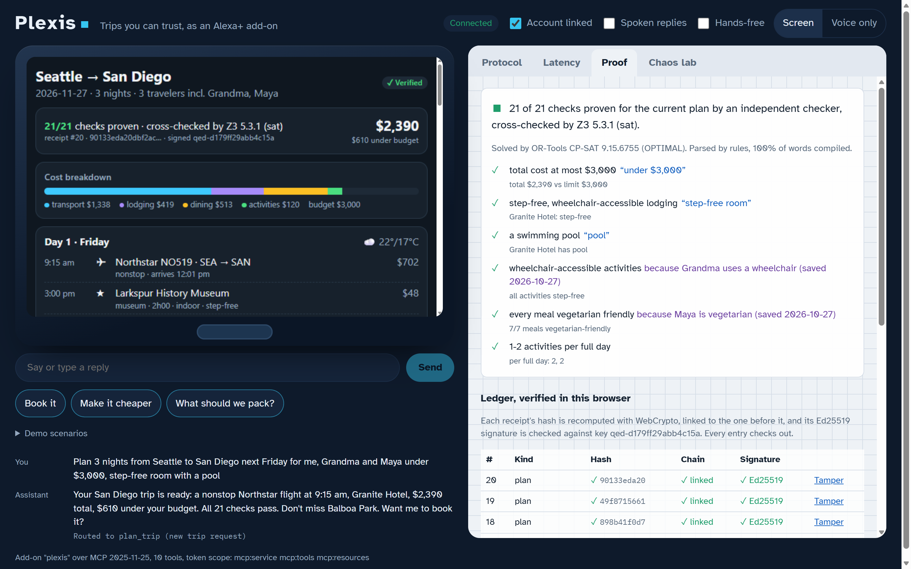
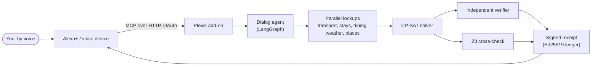

# Plexis: the trip agent that has to prove its answers

**AI travel agents will confidently book a trip that breaks your own rules: over budget, a red-eye you ruled out, a hotel with stairs Grandma can't climb. Plexis isn't allowed to guess.**

You talk to it like a person. It plans with a constraint solver, re-checks every rule with an independent verifier and a second solver, and signs each plan with a tamper-evident receipt. If your wishes can't all be met, it tells you exactly which ones clash and the smallest change that fixes it.

Built for the Amazon Developer Hackathon (Alexa+ track) as an **Alexa+ add-on**: an MCP server that Alexa+ (or any MCP client) talks to.

<p align="center"></p>



*Above: "3 nights in San Diego for me, Grandma and Maya, under $3,000, step-free room with a pool." Every rule is checked and linked to the words (or the remembered household fact) behind it, and the receipts are re-verified in the browser.* [Full demo video (1:38)](docs/media/plexis-demo.mp4)

## What it does

- **Asks what you forgot.** Destination, dates, budget, and room needs people often skip (AC or not, breakfast, a pool, among 30 researched preferences), with suggested answers when you're vague.
- **Plans with math, not guesswork.** Google OR-Tools CP-SAT finds the best plan that meets every rule.
- **Proves it.** An independent checker re-verifies every rule, and Z3 (or an arithmetic cost floor) cross-checks the result.
- **Signs it.** Each plan gets an Ed25519-signed, hash-chained receipt that anyone can verify.
- **Explains impossibility.** It finds the minimal set of clashing requirements and offers fixes it has already verified.
- **Keeps watching.** If a flight is cancelled, it has a checked replacement plan ready. It suggests better dates when the weather looks bad, and tells you what to pack.
- **Remembers your household, privately.** "Grandma uses a wheelchair" is remembered with consent, per signed-in user, and labelled wherever it shapes a plan.
- **Talks hands-free.** The voice device waits through natural pauses and lets you interrupt it mid-sentence.

## How it works



## Results

`plexis bench --n 80` ([full results](docs/benchmark/bench.md)): seeded requests, with the independent verifier as the judge.

| | Plexis | Greedy | Filter-greedy |
|---|---|---|---|
| Plans passing every check | **100%** | 13.8% | 25.0% |
| Wrong plan returned for an impossible request | **0%** | 100% | 60.0% |
| Independent cross-check agrees (Z3 or cost floor) | 100% | | |
| Latency p50 / p95 | 89 / 158 ms | | |

## Built with

Python · MCP Python SDK (protocol 2025-11-25, Streamable HTTP) · OR-Tools CP-SAT · Z3 · LangGraph · Pipecat (Silero VAD, Smart Turn v3, Whisper) · Ed25519 · SQLite · React + TypeScript (MCP TypeScript SDK) · Docker · Amazon Bedrock (Nova via Strands, Guardrails) · Amazon S3 · AgentCore

<details>
<summary><b>Engineering details</b></summary>

- **Alexa+ add-on conventions:** `structuredContent` with an `outputSchema`, `_meta.ui` pointing to an MCP App card for Echo Show, elicitation for payment consent and fix-it choices, duplicate-booking protection, two-tier OAuth (`client_credentials` for discovery, PKCE `authorization_code` for personal actions), and an `addon.json` manifest in `deploy/alexa-addon/`.
- **Partners:** 8 partner MCP servers (transport, stays, dining, experiences, weather, wallet, guide, a simulated front desk), queried in parallel.
- **Per-user privacy:** memory, learning, plans, trips and conversations belong to the signed-in user. Plan IDs are random and can't be derived from public receipts. Unlinked guests get no memory.
- **Durability:** plans and booked trips are stored in SQLite and re-verified after a restart, so cancellation monitoring survives restarts.
- **Booking:** a saga with rollback.
- **Learning:** a phrasebook you can teach ("when I say beachy I mean near the beach"), correction logging and habits.
- **Guardrails:** checks on input, on LLM provenance, on untrusted partner text and on spoken output.
- **Resilience and observability:** circuit breakers, retries, a stale cache, bulkheads, Prometheus metrics, OpenTelemetry tracing, and ledger backup and restore.
- **Voice turn-taking:** Silero VAD, Whisper, and Smart Turn v3 end-of-turn detection; barge-in with an echo filter; a follow-up window and wake word after a quiet spell.
- **Tests:** `pytest -q` runs 105 tests: unit, Hypothesis property and metamorphic checks, verifier mutation, live MCP contract, chaos scenarios, privacy, restart, and a latency SLO.

</details>


## Validation & Integration Scope

Plexis is a functional prototype with independently tested planning, constraint verification, and cryptographically signed receipts.

- **Travel services:** Eight partner MCP servers simulate travel and payment workflows using reproducible datasets. The architecture supports integration with live provider APIs.
- **Alexa+ compatibility:** Built around MCP and Alexa+ add-on conventions, with functionality demonstrated through an MCP-compatible simulator. Native Alexa+ deployment requires partner access.
- **AWS services:** Amazon Bedrock and AgentCore integration paths are implemented with graceful fallbacks. Live cloud validation remains outside the current evaluation scope.

The published benchmarks measure the core planning and verification system under controlled conditions, independently of external service availability.

## Repository layout

```
src/plexis/     the add-on: dialog agent, solver, verifier, receipts, MCP server, voice device
tests/          105 tests (unit, property, contract, chaos, privacy, timing)
simulator/      a simulated Alexa+ host (React + MCP TypeScript SDK)
deploy/         Alexa+ add-on manifest, AWS AgentCore guide, agent skill
docs/           demo media and benchmark results
```

## License

[MIT](LICENSE)
